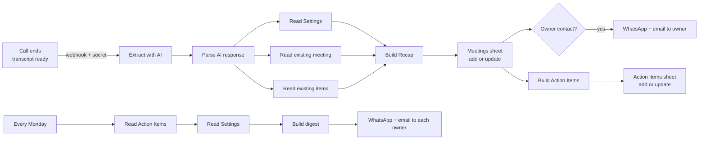

# How it works

*This page goes deep on purpose — it's the proof that the homepage summary is real and tested, not just copy.
You don't need to follow all of it to use the result.*

## The flow

All the business rules live in one file, `recap.js`. `build.js` copies it into the workflow's Code nodes, so the
rules that are tested are the same ones that run. The AI step only reads the free-text transcript for the
summary, action items, and risks — the account, contact, rep, and team come straight from the calendar/CRM
metadata your intake system already has, never from the AI's guess.

## Flags

A row is always written, flagged or not, so nothing silently disappears:

| Flag | Meaning |
|---|---|
| `Missing: account/deal name, meeting summary` | The intake payload or the AI's extraction didn't return a required field |
| `No action items captured` | The AI didn't find anything actionable in the transcript — worth a glance, not necessarily wrong |
| `Risk flagged: ...` | The AI noticed something worth attention: budget pushback, a competitor mention, a slipping timeline |
| `No owner set for team ...` | Nobody in Settings to alert for that team |

## When the same meeting comes in again

The workflow matches on the meeting ID (from Zoom, Google Meet, or whatever your calendar/transcript source
provides).

- **The Meetings row updates in place** rather than duplicating, keeping the original logged time.
- **Each action item's `Status` is never overwritten.** This is the opposite rule from how SnapTally treats a
  changed invoice total, and deliberately so: here, a human marking an item `Done` is tracking real-world
  progress that has nothing to do with whether the transcript gets re-processed, so a corrected re-run only
  refreshes an item's text — never undoes someone's checkmark.

## Weekly digest

- **Who it covers:** every action item across every meeting that isn't marked `Done`.
- **What counts as stale:** open 7 or more days.
- **Who's at the top:** the five open items waiting longest, oldest first.

It goes to every owner listed in Settings, as a nudge for anything that's gone quiet.

## What's real and what's sample

- **Real:** the workflow, the rules, and their tests (`node recap.test.js`).
- **Sample:**
  - `send-test.sh` posts one invented sample transcript with invented account/contact details.
  - The metadata fields in `fromExtraction()` (`account`, `contact`, `rep`, `team`) are a starting point — they
    assume your calendar or CRM already attaches this to the transcript webhook, which varies per client.
  - WhatsApp replies need a Meta-approved message template before the business can message a new contact first
    — that's Meta's rule, not a limitation of this workflow.

## Files

| File | What |
|---|---|
| `recap.js` | All rules: normalizing the AI's output, flags, the recap row, action-item tracking, the weekly digest |
| `recap.test.js` | Fixed-input checks for every rule (`node recap.test.js`) |
| `build.js` | Builds `workflow.json` with `recap.js` inlined into the Code nodes |
| `workflow.json` | Import into n8n (no credentials inside) |
| `payloads/`, `send-test.sh` | A sample meeting payload and the script that sends it |

## Build status

| Part | State |
|---|---|
| Rules (flags, recap row, action-item tracking, digest) | Built and tested, in Node and inside n8n |
| Workflow in n8n | Built, generic intake webhook → Claude text call → Sheets → alert |
| AI extraction step | Wired to call Claude's API; not yet run against a real transcript |
| Google Sheet end-to-end | Logic tested (`node recap.test.js`); not yet run against a live Sheet/Gmail |
| A real transcript source (Zoom/Meet/Teams webhook) | Not built yet — depends on which the client actually uses |
